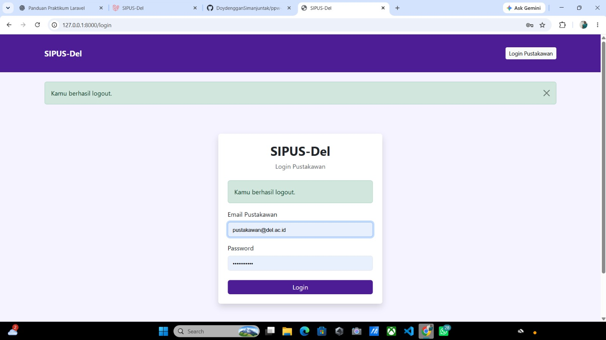
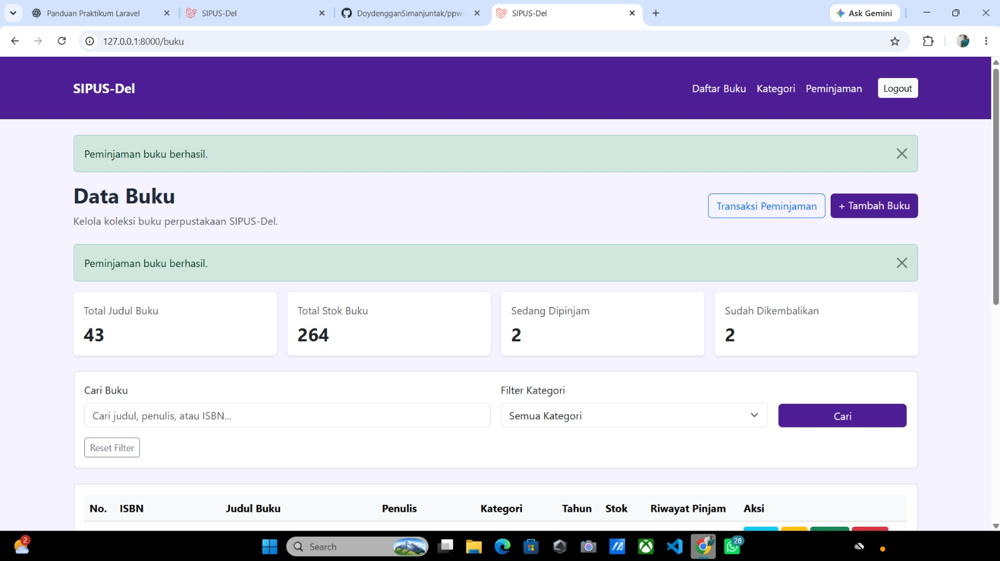
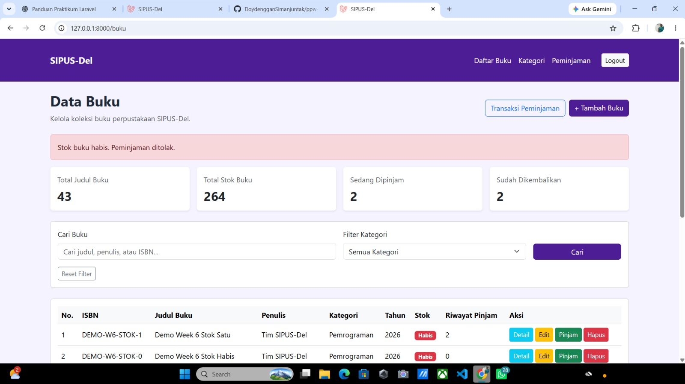
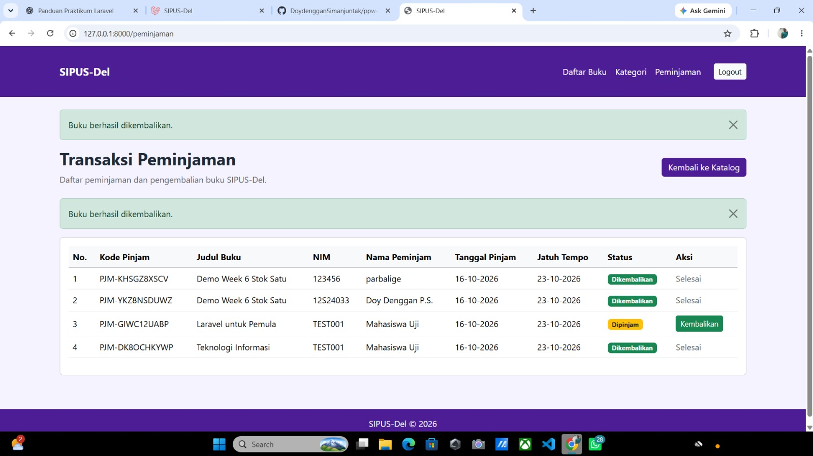
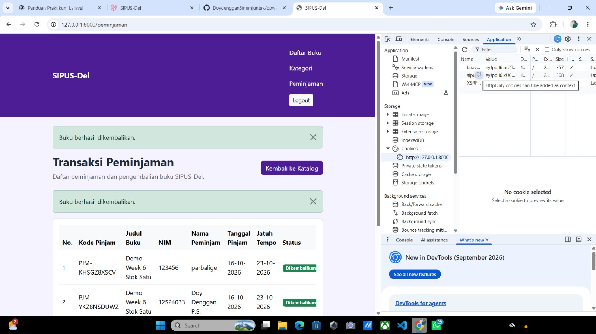

# SIPUS-Del — Sistem Informasi Perpustakaan

SIPUS-Del adalah aplikasi berbasis web menggunakan Laravel untuk mengelola koleksi buku, kategori, serta transaksi peminjaman dan pengembalian buku di perpustakaan.

## Fitur

### Pengelolaan Buku dan Kategori
- Menampilkan daftar buku dengan pagination.
- Menambah, melihat detail, mengubah, dan menghapus data buku.
- Mengelola kategori buku.
- Menghubungkan buku dan kategori menggunakan relasi database.
- Memvalidasi ISBN agar tidak duplikat.
- Memvalidasi judul dan stok buku.

### Peminjaman dan Pengembalian
- Mencatat transaksi peminjaman dengan kode pinjam.
- Mencatat NIM dan nama peminjam.
- Menetapkan tanggal pinjam dan tanggal jatuh tempo.
- Menolak peminjaman jika stok buku habis.
- Mencegah peminjam meminjam buku yang sama lagi sebelum mengembalikannya.
- Mengurangi stok saat peminjaman berhasil.
- Menambah stok saat buku dikembalikan.
- Menyimpan status dan tanggal pengembalian.
- Menggunakan transaksi database dan `lockForUpdate()` untuk membantu menjaga konsistensi data.
- Mencatat kesalahan database melalui logging.

### Pencarian dan Statistik
- Mencari buku berdasarkan judul, penulis, atau ISBN.
- Memfilter buku berdasarkan kategori.
- Mempertahankan parameter pencarian saat berpindah halaman.
- Menampilkan statistik jumlah judul, total stok, peminjaman aktif, dan buku yang sudah dikembalikan.

### Autentikasi dan Session
- Login dan logout pustakawan.
- Melindungi halaman dan operasi pengelolaan melalui autentikasi.
- Memperbarui session setelah login dan menginvalidasi session saat logout.
- Menyimpan informasi pencarian dan peminjam terakhir di session.
- Menggunakan cookie `sipus_last_login` dengan atribut HttpOnly.

## Teknologi

- Laravel
- PHP
- SQLite
- Blade Template
- Bootstrap 5.3.3
- Laravel Sanctum
- OpenLibrary API

## Struktur Database

### Tabel `kategoris`
Menyimpan data kategori buku.

### Tabel `bukus`
Menyimpan data buku, termasuk ISBN, judul, penulis, penerbit, tahun terbit, kategori, stok, dan sinopsis.

### Tabel `peminjamans`
Menyimpan transaksi peminjaman, termasuk kode pinjam, buku, NIM, nama peminjam, tanggal pinjam, tanggal jatuh tempo, tanggal kembali, dan status transaksi.

Relasi utama:
- Satu kategori dapat memiliki banyak buku.
- Satu buku dapat memiliki banyak riwayat peminjaman.
- Setiap transaksi peminjaman terhubung ke satu buku.

## Persyaratan

Pastikan perangkat sudah memiliki:
- PHP yang sesuai dengan versi Laravel proyek.
- Composer.
- Git.

## Cara Instalasi

1. Clone repository:

   ```bash
   git clone https://github.com/DoydengganSimanjuntak/ppw-2026-week5-12S24033.git
   ```

2. Masuk ke folder proyek:

   ```bash
   cd ppw-2026-week5-12S24033
   ```

3. Instal dependensi:

   ```bash
   composer install
   ```

4. Buat file `.env` dari contoh:

   ```bash
   cp .env.example .env
   ```

   Pada Windows Command Prompt, gunakan:

   ```cmd
   copy .env.example .env
   ```

5. Buat application key:

   ```bash
   php artisan key:generate
   ```

6. Buat file database SQLite `database/database.sqlite` jika belum tersedia.

7. Atur koneksi database di `.env`:

   ```env
   DB_CONNECTION=sqlite
   ```

8. Jalankan migrasi dan seeder:

   ```bash
   php artisan migrate --seed
   ```

9. Jalankan aplikasi:

   ```bash
   php artisan serve
   ```

10. Buka aplikasi melalui:

    http://127.0.0.1:8000

## Akun Pustakawan untuk Pengujian

Seeder pustakawan menyediakan akun pengujian berikut:

- **Email:** `pustakawan@del.ac.id`
- **Password:** `password123`

Gunakan akun ini hanya untuk lingkungan praktikum lokal. Jangan gunakan password tersebut untuk akun nyata.

## Pengujian yang Dilakukan

- Login dan logout pustakawan.
- Peminjaman buku ketika stok tersedia.
- Penolakan peminjaman ketika stok habis.
- Pengurangan stok saat peminjaman berhasil.
- Pengembalian buku, pembaruan status, dan penambahan stok.
- Pencarian dan filter katalog buku.
- Pemeriksaan cookie `sipus_last_login` dengan atribut HttpOnly melalui Developer Tools browser.

## Bukti Pengujian

Berikut merupakan dokumentasi hasil pengujian aplikasi SIPUS-Del. Screenshot disimpan di folder `docs/screenshots/`.

### 1. Login Pustakawan



### 2. Peminjaman Berhasil



### 3. Penolakan Peminjaman Saat Stok Habis



### 4. Pengembalian Buku



### 5. Pemeriksaan Cookie HttpOnly



## Pengembang

- **Nama:** Doy Denggan Simanjuntak
- **Program Studi:** Sistem Informasi
- **Institusi:** Institut Teknologi Del
- **Mata Kuliah:** Pemrograman dan Pengujian Aplikasi Web

## Repository

[GitHub — SIPUS-Del Week 6](https://github.com/DoydengganSimanjuntak/ppw-2026-week5-12S24033/tree/week6-db-session)

---

# Week 9 — Web Services dan REST API

## 1. Analisis Kelayakan Web Service

Pengembangan Web Service pada SIPUS-Del dinilai layak karena sistem perpustakaan berpotensi diintegrasikan dengan aplikasi lain, seperti aplikasi mobile dan mesin kiosk perpustakaan.

Dengan adanya Web Service, aplikasi lain dapat mengakses layanan katalog dan sirkulasi melalui endpoint yang disediakan oleh backend SIPUS-Del tanpa harus mengakses database secara langsung.

Penerapan Web Service memberikan beberapa manfaat:
- Mempermudah integrasi dengan aplikasi lain.
- Memungkinkan layanan diakses melalui berbagai perangkat.
- Memisahkan backend dengan aplikasi yang menggunakan layanan.
- Mempermudah pengembangan sistem di masa mendatang.

## 2. Web Service Provider dan Consumer

Dalam implementasi ini, SIPUS-Del memiliki dua peran.

**Sebagai Web Service Provider**

SIPUS-Del bertindak sebagai Provider karena menyediakan REST API untuk katalog buku, autentikasi, peminjaman, dan pengembalian buku. SIPUS-Del juga menyediakan layanan SOAP untuk pemeriksaan status peminjaman.

**Sebagai Web Service Consumer**

SIPUS-Del bertindak sebagai Consumer ketika menggunakan OpenLibrary API untuk memperoleh informasi buku berdasarkan ISBN.

Aplikasi mobile atau kiosk juga dapat menjadi Consumer apabila menggunakan endpoint yang disediakan SIPUS-Del.

## 3. Pemilihan REST dan SOAP

**REST API**

REST API digunakan untuk layanan katalog buku, autentikasi, peminjaman, dan pengembalian. Komunikasi menggunakan HTTP dengan format JSON.

REST dipilih karena relatif sederhana, ringan, dan mudah diintegrasikan dengan aplikasi web maupun mobile.

**SOAP**

SOAP digunakan untuk operasi `CheckClearanceStatus`, yaitu pemeriksaan jumlah peminjaman yang masih aktif berdasarkan NIM peminjam.

SOAP menggunakan pesan XML sehingga struktur permintaan dan respons dapat ditentukan secara jelas.

## 4. Implementasi REST API

REST API SIPUS-Del menggunakan prefix `/api/v1` untuk membedakan versi layanan.

| Method | Endpoint | Keterangan |
|---|---|---|
| POST | `/api/v1/login` | Login dan memperoleh Bearer Token |
| POST | `/api/v1/logout` | Logout dan menghapus token aktif |
| GET | `/api/user` | Mendapatkan informasi pengguna terautentikasi |
| GET | `/api/v1/bukus` | Menampilkan daftar buku |
| GET | `/api/v1/bukus/{id}` | Menampilkan detail buku |
| POST | `/api/v1/peminjamans` | Membuat transaksi peminjaman |
| POST | `/api/v1/peminjamans/{id}/pengembalian` | Mengembalikan buku |
| GET | `/api/v1/openlibrary/{isbn}` | Mengambil informasi buku dari OpenLibrary |

### Fitur REST API Katalog

Endpoint katalog mendukung:
- Pencarian berdasarkan judul dan penulis.
- Filter berdasarkan `kategori_id`.
- Pengurutan berdasarkan judul, penulis, tahun terbit, stok, dan waktu pembuatan.
- Pengurutan naik (`asc`) dan turun (`desc`).
- Pagination dengan jumlah data per halaman maksimal 50.
- Detail buku beserta informasi kategori.

Respons katalog menggunakan `BukuResource` dan menyediakan tautan `_links` untuk detail buku dan koleksi.

### Peminjaman dan Pengembalian melalui API

Pembuatan peminjaman menggunakan validasi data dan transaksi database. Jika stok tersedia, sistem mengurangi stok buku dan membuat transaksi peminjaman.

Jika stok tidak tersedia, sistem mengembalikan kesalahan HTTP 422.

Pengembalian buku mengubah status peminjaman menjadi `dikembalikan`, mengisi tanggal pengembalian, dan menambahkan kembali stok buku.

Jika transaksi sudah dikembalikan sebelumnya, sistem memberikan respons HTTP 409 Conflict.

## 5. Autentikasi Menggunakan Laravel Sanctum

REST API SIPUS-Del menggunakan Laravel Sanctum untuk autentikasi berbasis Bearer Token.

Alur autentikasi:
1. Pengguna mengirim email dan password ke endpoint login.
2. Sistem memeriksa data pengguna.
3. Jika berhasil, sistem membuat token menggunakan Sanctum.
4. Token digunakan pada header Authorization untuk mengakses endpoint yang dilindungi.
5. Pengguna dapat melakukan logout untuk menghapus token aktif.

Format header:

```http
Authorization: Bearer {token}
```

Endpoint peminjaman dan pengembalian dilindungi menggunakan middleware `auth:sanctum`.

## 6. Integrasi OpenLibrary API

SIPUS-Del menggunakan OpenLibrary sebagai layanan eksternal untuk mencari informasi buku berdasarkan ISBN.

Integrasi dilakukan menggunakan Laravel HTTP Client melalui `Http` facade.

Informasi yang diambil meliputi:
- ISBN.
- Judul buku.
- Jumlah halaman.
- Tanggal terbit.
- Penerbit.

Jika data buku tidak ditemukan, API SIPUS-Del memberikan respons HTTP 404.

## 7. Implementasi SOAP Web Service

SIPUS-Del menyediakan dua endpoint SOAP:

- `GET /soap/sipus.wsdl` untuk memperoleh deskripsi layanan WSDL.
- `POST /soap/sipus` untuk menjalankan operasi `CheckClearanceStatus`.

Operasi `CheckClearanceStatus` menerima NIM peminjam melalui SOAP Envelope. Sistem menghitung transaksi pada tabel `peminjamans` yang memiliki status `dipinjam`, kemudian mengembalikan jumlah peminjaman aktif dalam respons XML.

## 8. Format Error API Berdasarkan RFC 7807

REST API SIPUS-Del menerapkan format Problem Details berdasarkan RFC 7807 untuk memberikan respons kesalahan secara terstruktur.

Format respons terdiri dari:
- `type`: referensi jenis masalah.
- `title`: judul kesalahan.
- `status`: kode status HTTP.
- `detail`: penjelasan kesalahan.

Beberapa kondisi yang telah diuji:
- HTTP 401 Unauthorized ketika pengguna belum terautentikasi.
- HTTP 404 Not Found ketika data buku tidak ditemukan.
- HTTP 422 Unprocessable Content ketika data tidak valid.

## 9. Dokumentasi OpenAPI

Dokumentasi REST API disimpan dalam file:

`docs/openapi-sipus-v1.yaml`

Dokumentasi tersebut memuat informasi endpoint, metode HTTP, parameter, autentikasi Bearer Token, request, dan respons API SIPUS-Del.